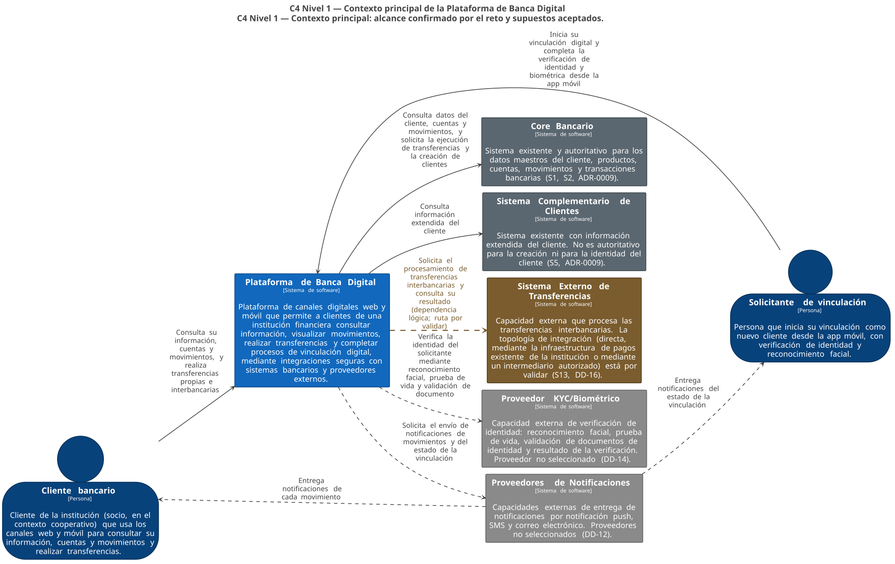
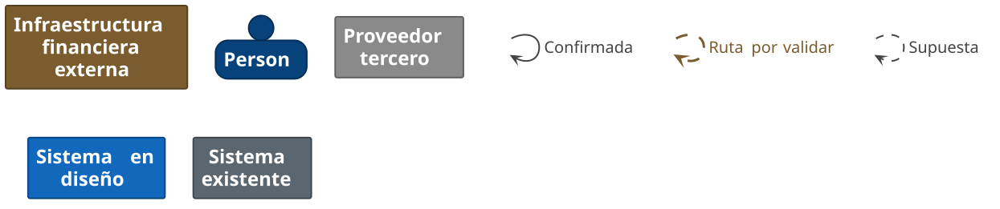
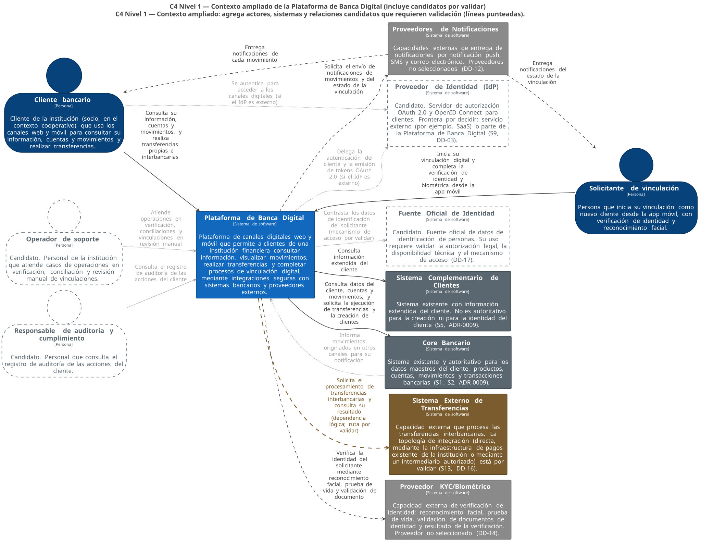
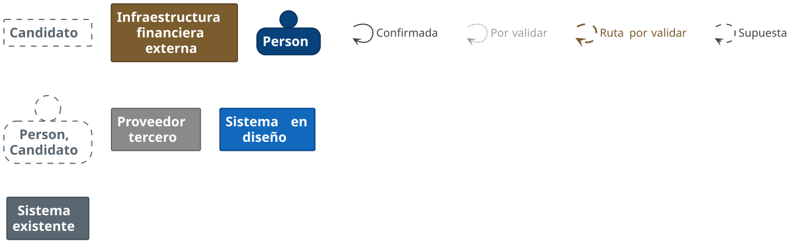

# 12 — Contexto del sistema (C4 Nivel 1)

| Campo | Valor |
|---|---|
| Fase | 2 — C4 Nivel 1: Contexto del sistema |
| Estado | Cerrado. Pendiente de aprobación del comité de arquitectura |
| Fuente autoritativa | [`c4/workspace.dsl`](../c4/workspace.dsl), vistas `ContextoPrincipal` y `ContextoAmpliado` |
| Documentos relacionados | [13 — Catálogo de integraciones](13-catalogo-de-integraciones.md), [14 — Límites de confianza](14-limites-de-confianza.md), [15 — Preguntas abiertas de la Fase 2](15-preguntas-abiertas-fase-2.md) |

## 1. Propósito y alcance

Este documento describe la Plataforma de Banca Digital en su entorno: quién la usa, con qué sistemas se relaciona y con qué propósito de negocio. Corresponde al **nivel 1 del modelo C4** (*System Context*).

**Dentro del alcance del nivel 1:**

- personas;
- el sistema en diseño;
- los sistemas de software externos;
- las relaciones y sus propósitos;
- las fronteras del sistema.

**Fuera del alcance del nivel 1** (se modelan en la Fase 3 o posteriores):

- aplicaciones web y móvil;
- API Gateway y BFF;
- servicios y ACL;
- bases de datos y caché;
- intermediarios de mensajería (*brokers*);
- frameworks e infraestructura cloud.

El diagrama de contexto es **agnóstico de la tecnología**.

### 1.1 Dos vistas complementarias

| Vista | Contenido | Uso |
|---|---|---|
| **Contexto principal** (`ContextoPrincipal`) | Alcance confirmado por el reto y supuestos arquitectónicos aceptados | Vista de referencia para el comité y la gerencia |
| **Contexto ampliado** (`ContextoAmpliado`) | Agrega actores, sistemas y relaciones **candidatos** que requieren validación | Conducir la validación con la institución |

Así, ninguna relación especulativa se presenta como un hecho confirmado.

### 1.2 Diagramas

#### Contexto principal

#### Contexto ampliado

**Convención visual:**

| Elemento | Representación |
|---|---|
| Relación confirmada | Línea continua |
| Relación supuesta | Línea discontinua |
| Dependencia confirmada con ruta por validar (REL-05) | Línea discontinua gruesa de color ocre. La dependencia es del reto; la conexión directa no está confirmada (remediación ARG01-M07) |
| Relación por validar | Línea punteada gris (solo en la vista ampliada) |
| Elemento candidato | Borde discontinuo, fondo blanco |

Los diagramas en `diagrams/c4/` se **generan** a partir del DSL; no se editan a mano (ver [README](../README.md#herramientas)).

## 2. Sistema en diseño

> **Plataforma de Banca Digital.** Plataforma de canales digitales web y móvil que permite a clientes de una institución financiera consultar información, visualizar movimientos, realizar transferencias y completar procesos de vinculación digital, mediante integraciones seguras con sistemas bancarios y proveedores externos.

Se representa como **un único sistema de software**. La SPA web y la app móvil son **contenedores** de este sistema (Fase 3), no sistemas separados. La razón es que comparten propietario, ciclo de evolución y frontera de responsabilidad.

## 3. Actores

### 3.1 Actores confirmados

| Actor | Responsabilidades frente a la plataforma | Fuente |
|---|---|---|
| **Cliente bancario** | Consulta su información, cuentas y movimientos. Realiza transferencias propias e interbancarias. Recibe notificaciones de cada movimiento. En el contexto cooperativo, socio (S15) | Reto: contexto, R1, R4, R6 |
| **Solicitante de vinculación** | Inicia la vinculación desde la app móvil. Entrega información de identidad. Completa la verificación biométrica (reconocimiento facial). Recibe el estado de su vinculación | Reto: R3 |

El solicitante se modela como un actor distinto del cliente porque **todavía no es cliente**: hasta que el Core confirma su creación ([ADR-0009](adr/ADR-0009-core-autoritativo.md)), no tiene productos, cuentas ni las mismas autorizaciones.

### 3.2 Actores candidatos (no incluidos en la vista principal)

| Actor candidato | Por qué podría existir | Por qué no se confirma | Validación requerida |
|---|---|---|---|
| **Operador de soporte** | Las decisiones de la Fase 1 crean casos que requieren intervención humana: `REQUIRES_RECONCILIATION` ([ADR-0005](adr/ADR-0005-maquina-de-estados-transaccional.md)), conciliación ambigua ([ADR-0006](adr/ADR-0006-idempotencia-y-conciliacion.md)) y `MANUAL_REVIEW` del onboarding ([ADR-0009](adr/ADR-0009-core-autoritativo.md)) | El reto no menciona usuarios internos. Pueden interactuar con la plataforma (consola administrativa propia) o con un **sistema administrativo separado** de la institución | DD-18, Q-08 |
| **Responsable de auditoría y cumplimiento** | R5 exige una base de datos de auditoría de todas las acciones del cliente; alguien la consultará | El reto no indica quién consulta la auditoría ni por qué medio. Podría hacerlo mediante herramientas institucionales de auditoría o de SIEM, sin interactuar con la plataforma | DD-18, Q-08 |

**Conclusión:** la existencia de estos actores es probable, pero **su interacción directa con la plataforma no está respaldada por el reto**. Se registran como candidatos en la vista ampliada y su frontera se decide con la institución.

## 4. Sistemas externos

| Sistema | Clasificación | Responsabilidad en el contexto | Confianza | Referencia |
|---|---|---|---|---|
| **Core Bancario** | Sistema existente de la institución | Autoritativo para los datos maestros del cliente, productos, cuentas, movimientos y transacciones. No se inventan sus interfaces (S3) | Confirmada | S1, S2, [ADR-0009](adr/ADR-0009-core-autoritativo.md) |
| **Sistema Complementario de Clientes** | Sistema existente de la institución | Información extendida del cliente. **No** es autoritativo para la creación ni para la identidad del cliente | Confirmada | S5, [ADR-0009](adr/ADR-0009-core-autoritativo.md) |
| **Sistema Externo de Transferencias** | Infraestructura financiera externa | Procesamiento de transferencias interbancarias. Representa una **capacidad lógica**; la topología de integración está por validar (sección 4.1) | Confirmada como dependencia; topología por validar | R1, S13, DD-16 |
| **Proveedor KYC/Biométrico** | Proveedor tercero | Reconocimiento facial, prueba de vida (*liveness detection*), validación de documentos de identidad y resultado de la verificación. **Proveedor no seleccionado** | Supuesta (S16) | R2, R3, DD-14 |
| **Proveedores de Notificaciones** | Proveedores terceros | Entrega de notificaciones push, SMS y correo electrónico. **Proveedores no seleccionados** | Supuesta (S17) | R4, DD-12 |
| **Proveedor de Identidad (IdP)** | Candidato; frontera por decidir | Servidor de autorización OAuth 2.0 y OpenID Connect para clientes (sección 4.2) | Por validar | R2, S9, DD-03 |
| **Fuente Oficial de Identidad** | Candidato | Fuente oficial de datos de identificación de personas (sección 4.3) | Por validar | DD-17 |

**No se modela** la «base de datos principal» que el reto menciona. Es un elemento interno de los sistemas existentes, y la plataforma no accede a ella (S12).

### 4.1 Sistema Externo de Transferencias: modelos de integración posibles

**No se asume una conexión directa con el BCE ni con el SPI.** La relación del diagrama (REL-05) expresa una **dependencia lógica**: la plataforma necesita que una transferencia interbancaria sea procesada por una capacidad externa. No expresa una conexión de red directa.

| Modelo | Descripción | Condiciones | Implicaciones |
|---|---|---|---|
| **A. Integración directa** | La plataforma se integra directamente con la infraestructura de pagos interbancarios | Solo si es legal y técnicamente admisible para la institución y su rol de participante | Mayor control y mayor carga regulatoria y de certificación sobre la plataforma |
| **B. Mediante la infraestructura de pagos existente de la institución** | La plataforma solicita la transferencia al Core o al componente de pagos que la institución ya opera, y este se comunica con el sistema de pagos | Que la infraestructura actual exponga una interfaz usable por el canal digital | Reutiliza los controles existentes. Para la plataforma, la transferencia interbancaria podría ser una operación más del Core |
| **C. Mediante un intermediario autorizado o un servicio bancario** | Un tercero autorizado procesa la transferencia en nombre de la institución | Que exista un acuerdo contractual y una autorización regulatoria | Agrega un proveedor crítico con su propio SLA y su propio riesgo |

La topología final es la **pregunta abierta Q-01** y la **decisión diferida DD-16**. Su resolución afecta a la máquina de estados (los estados `DEBIT_CONFIRMED` y `PENDING_EXTERNAL_CONFIRMATION` de [ADR-0005](adr/ADR-0005-maquina-de-estados-transaccional.md), este último antes llamado `SPI_PROCESSING`) y al catálogo de integraciones.

### 4.2 Proveedor de Identidad: frontera por decidir

El reto exige OAuth 2.0 (R2). Se asume que la institución no tiene un IdP moderno para clientes (S9). Hay dos alternativas de frontera:

| Alternativa | Representación en C4 | Implicación |
|---|---|---|
| **IdP como servicio externo** (por ejemplo, un servicio gestionado por un tercero) | Sistema de software externo, como en la vista ampliada | Proveedor tercero que trata credenciales y datos de autenticación: riesgo de tercero y de residencia de datos |
| **IdP como parte de la plataforma** (producto desplegado y operado por la institución dentro de la plataforma) | Contenedor de la Plataforma de Banca Digital (Fase 3); no aparece en el nivel 1 | Mayor control, mayor responsabilidad operativa |

Por eso **el IdP no aparece en la vista principal**. La decisión de frontera forma parte de DD-03 y debe tomarse **antes del diseño de contenedores**, porque cambia el contenido del diagrama de la Fase 3. No se selecciona ningún producto.

### 4.3 Fuente Oficial de Identidad

Es un sistema **candidato**, no una integración confirmada. Su uso requiere validar:

- la **autorización legal** para consultar datos de identificación;
- la **disponibilidad técnica** de un servicio;
- el **mecanismo de acceso** apropiado.

En la vista ampliada, la relación se dibuja desde la plataforma. Es igualmente posible que la consulta la haga el Proveedor KYC/Biométrico como parte de su servicio. **No se dibuja una relación entre el proveedor KYC y la fuente oficial** porque sería inventar una conectividad entre sistemas externos sin evidencia (Q-07).

## 5. Catálogo de relaciones

| ID | Origen | Destino | Descripción (acción) | Propósito de negocio | Confianza | Vista |
|---|---|---|---|---|---|---|
| REL-01 | Cliente bancario | Plataforma | Consulta su información, cuentas y movimientos, y realiza transferencias propias e interbancarias | Autoservicio financiero digital | Confirmada | Principal |
| REL-02 | Solicitante de vinculación | Plataforma | Inicia su vinculación digital y completa la verificación de identidad y biométrica desde la app móvil | Captación de nuevos clientes por el canal digital | Confirmada | Principal |
| REL-03 | Plataforma | Core Bancario | Consulta datos del cliente, cuentas y movimientos, y solicita la ejecución de transferencias y la creación de clientes | Acceder a la fuente autoritativa y registrar las operaciones donde residen las cuentas | Confirmada (consultas); ADR-0009 (creación) | Principal |
| REL-04 | Plataforma | Sistema Complementario | Consulta información extendida del cliente | Completar la vista del cliente | Confirmada | Principal |
| REL-05 | Plataforma | Sistema Externo de Transferencias | Solicita el procesamiento de transferencias interbancarias y consulta su resultado (dependencia lógica; ruta por validar) | Transferir fondos a otras instituciones | Dependencia confirmada; ruta por validar | Principal |
| REL-06 | Plataforma | Proveedor KYC/Biométrico | Verifica la identidad del solicitante mediante reconocimiento facial, prueba de vida y validación de documento | Conocimiento del cliente y prevención de suplantación | Supuesta (S16) | Principal |
| REL-07 | Plataforma | Proveedores de Notificaciones | Solicita el envío de notificaciones de movimientos y del estado de la vinculación | Notificar cada movimiento (R4) e informar el avance de la vinculación | Supuesta (S17) | Principal |
| REL-08 | Proveedores de Notificaciones | Cliente bancario | Entrega notificaciones de cada movimiento | Cumplir R4 | Supuesta (S17) | Principal |
| REL-09 | Proveedores de Notificaciones | Solicitante de vinculación | Entrega notificaciones del estado de la vinculación | Comunicar los estados intermedios del onboarding | Supuesta (S17) | Principal |
| REL-10 | Cliente bancario | IdP | Se autentica para acceder a los canales digitales (si el IdP es externo) | Autenticación del cliente (R2) | Por validar (DD-03) | Ampliada |
| REL-11 | Plataforma | IdP | Delega la autenticación del cliente y la emisión de tokens OAuth 2.0 (si el IdP es externo) | Autorización de acceso a las API (R2) | Por validar (DD-03) | Ampliada |
| REL-12 | Plataforma | Fuente Oficial de Identidad | Contrasta los datos de identificación del solicitante (mecanismo de acceso por validar) | Fortalecer la verificación de identidad | Por validar (DD-17) | Ampliada |
| REL-13 | Core Bancario | Plataforma | Informa movimientos originados en otros canales para su notificación | Notificar movimientos que no originó la plataforma (alcance de R4) | Por validar (Q-04) | Ampliada |
| REL-14 | Operador de soporte | Plataforma | Atiende operaciones en verificación, conciliaciones y vinculaciones en revisión manual | Resolver `REQUIRES_RECONCILIATION` y `MANUAL_REVIEW` | Por validar (DD-18) | Ampliada |
| REL-15 | Responsable de auditoría y cumplimiento | Plataforma | Consulta el registro de auditoría de las acciones del cliente | Atención de reclamos, investigación y supervisión (R5) | Por validar (DD-18) | Ampliada |

Notas:

- **Ningún actor accede directamente al Core.** Todo acceso del cliente pasa por la plataforma.
- **No se modelan relaciones entre sistemas externos.** Por ejemplo, Core ↔ Sistema Externo de Transferencias, o KYC ↔ Fuente Oficial. Su existencia depende de Q-01 y Q-07.
- Las relaciones de los Proveedores de Notificaciones hacia las personas representan la **entrega** del mensaje fuera del control de la plataforma (ver [14](14-limites-de-confianza.md)).

## 6. Fronteras del sistema

| Frontera | Dentro | Fuera |
|---|---|---|
| Plataforma de Banca Digital | Canales web y móvil, exposición y protección de API, lógica de dominio de canales, ACL, estado transaccional, caché, auditoría de la plataforma (detalle en la Fase 3) | Core, Sistema Complementario, base de datos principal, sistema de pagos, proveedores terceros |
| Responsabilidad sobre los datos | Estado de las operaciones digitales, auditoría de acciones del cliente en el canal, datos derivados (caché) | Datos autoritativos de clientes, cuentas y movimientos (Core); datos extendidos (Sistema Complementario) |

**Frontera de software ≠ frontera de confianza.** La SPA y la app móvil pertenecen al sistema en diseño (frontera C4), pero se ejecutan en dispositivos y redes **no confiables** (frontera de confianza). Esta distinción se desarrolla en [14 — Límites de confianza](14-limites-de-confianza.md), con una vista conceptual separada para no distorsionar el diagrama C4.

## 7. Límites de confianza (resumen)

| ID | Zona | Elementos |
|---|---|---|
| TB-1 | Canales digitales públicos | Dispositivos del cliente, navegador, app móvil en ejecución, Internet |
| TB-2 | Plataforma de Banca Digital | Componentes de servidor de la plataforma |
| TB-3 | Sistemas bancarios existentes | Core Bancario, Sistema Complementario, base de datos principal |
| TB-4 | Proveedores terceros | KYC/Biometría, Notificaciones, IdP (si es externo) |
| TB-5 | Infraestructura financiera externa | Sistema Externo de Transferencias y la infraestructura de pagos interbancarios |

Detalle de los cruces y de sus implicaciones de seguridad en [14](14-limites-de-confianza.md).

## 8. Supuestos arquitectónicos aplicables

| Supuesto | Aplicación en el contexto |
|---|---|
| S1, S2 | Core externo y autoritativo |
| S5 | Sistema Complementario externo y no autoritativo para la identidad |
| S9 | Sin IdP moderno; IdP como candidato con frontera por decidir |
| S12 | La base de datos principal no se modela; no hay acceso directo |
| S13 (revisado en la Fase 2) | No se asume integración directa con el BCE/SPI; tres modelos posibles |
| S15 | «Cliente bancario» equivale a «socio» en el contexto cooperativo |
| **S16 (nuevo)** | Las capacidades de KYC y biometría las provee un tercero especializado |
| **S17 (nuevo)** | La entrega de notificaciones push, SMS y correo usa proveedores externos |

Detalle en [02 — Supuestos](02-supuestos.md).

## 9. Preguntas abiertas

Las preguntas priorizadas por impacto están en [15 — Preguntas abiertas de la Fase 2](15-preguntas-abiertas-fase-2.md). Las de mayor impacto sobre la Fase 3 son:

- **Q-01:** topología de las transferencias interbancarias.
- **Q-03:** frontera del IdP.
- **Q-04:** alcance de «notificar cada movimiento».
- **Q-06:** tratamiento de datos biométricos por terceros.

## 10. Trazabilidad con los requisitos

| Requisito | Representación en el contexto | Cobertura en el nivel 1 |
|---|---|---|
| R1 | REL-01, REL-03, REL-04, REL-05 | **Parcial.** El nivel 1 muestra los sistemas involucrados. El API Gateway y los tres servicios son elementos de la Fase 3 |
| R2 | REL-06; IdP como candidato (REL-10, REL-11) | **Parcial.** El flujo OAuth y el IdP están pendientes (DD-03) |
| R3 | Solicitante de vinculación, REL-02, REL-06, REL-03 (creación de cliente) | **Parcial.** Los métodos de acceso posteriores y las herramientas están pendientes |
| R4 | REL-07, REL-08, REL-09; REL-13 por validar | **Parcial.** Los canales concretos y el alcance de «cada movimiento» están pendientes (Q-04) |
| R5 | Auditor candidato (REL-15) | **No cubierto en el nivel 1.** La base de datos de auditoría y la caché son de la Fase 3 |
| R6 | Cliente y solicitante usan la plataforma | **No cubierto en el nivel 1.** Los stacks de frontend son de la fase de frontend |
| C1–C6 | Límites de confianza ([14](14-limites-de-confianza.md)) como base de C1 y C4 | **Parcial o pendiente** |

La matriz completa está en [09 — Trazabilidad de requisitos](09-trazabilidad-de-requisitos.md#6-representación-en-el-contexto-del-sistema-fase-2). **Un diagrama de nivel 1 no satisface por sí solo** requisitos que se resuelven en los niveles de contenedor, de componente o de infraestructura.

## 11. Implicaciones para la Fase 3 (Contenedores)

1. **Contenedores de canal:** la SPA web y la app móvil son contenedores de la plataforma que se ejecutan en TB-1. Deben tratarse como clientes no confiables: sin secretos de servidor y con todas las reglas aplicadas en el servidor.
2. **API Gateway** como contenedor de borde ([ADR-0002](adr/ADR-0002-frontera-api-gateway.md)). Debe enrutar al menos hacia los servicios de clientes, movimientos y transferencias (R1).
3. **Servicios de dominio y ACL** según [ADR-0001](adr/ADR-0001-acl-por-dominio.md). Habrá una ACL hacia el Core y otra hacia el Sistema Complementario. La integración con el Sistema Externo de Transferencias depende de Q-01: en el modelo B podría ser solo otra operación de la ACL de transferencias hacia el Core.
4. **Onboarding:** contenedor o servicio responsable de la máquina de estados de vinculación ([ADR-0009](adr/ADR-0009-core-autoritativo.md)), con integración hacia el Proveedor KYC/Biométrico.
5. **Notificaciones:** se necesita un mecanismo de despacho desacoplado de la transacción. Su diseño puede activar DD-01 (bus de eventos).
6. **Auditoría (R5) y caché ([ADR-0004](adr/ADR-0004-cache-aside.md))** como contenedores de datos de la plataforma.
7. **Precondición:** decidir la frontera del IdP (DD-03, Q-03) antes de cerrar el diagrama de contenedores.
8. **Precondición recomendada:** tener al menos una respuesta preliminar a Q-01 y Q-04.

## 12. Revisión de calidad arquitectónica (autoevaluación)

| # | Pregunta | Evaluación | Acción tomada |
|---|---|---|---|
| 1 | ¿Las fronteras del sistema son claras? | Sí. Un único sistema en diseño; los sistemas existentes y los terceros están fuera | — |
| 2 | ¿Se muestran componentes internos como sistemas externos? | No. El API Gateway, el BFF, la caché, la auditoría y las apps no aparecen. El IdP, que podría ser interno, se separó a la vista ampliada como candidato con frontera por decidir | IdP retirado de la vista principal |
| 3 | ¿Falta algún actor? | Posiblemente actores internos (soporte, auditoría). También podrían faltar sistemas no mencionados por el reto: prevención de fraude, listas de control para la prevención de lavado de activos, SIEM institucional | Registrados como candidatos o como preguntas (Q-08, Q-12, Q-13) |
| 4 | ¿Hay actores especulativos? | Los dos actores internos lo son | Solo en la vista ampliada, con estilo de candidato |
| 5 | ¿Cada relación tiene justificación de negocio? | Sí. La sección 5 indica el propósito de cada una | — |
| 6 | ¿El Core se representa como externo y autoritativo? | Sí | — |
| 7 | ¿El Sistema Complementario está correctamente separado? | Sí. Es un sistema propio, no autoritativo para la identidad | — |
| 8 | ¿Las dependencias externas de transferencias son precisas? | Se representan como capacidad lógica con la topología por validar. La relación directa desde la plataforma es una dependencia lógica y no implica conectividad directa | Aclarado en la sección 4.1 y en la descripción de REL-05 |
| 9 | ¿Se asumió integración directa con el BCE/SPI sin evidencia? | No. El supuesto S13 se revisó para eliminar cualquier compromiso de topología | S13 actualizado |
| 10 | ¿La frontera del IdP está documentada? | Sí (sección 4.2, DD-03) | — |
| 11 | ¿KYC y biometría están sin selección prematura de proveedor? | Sí | — |
| 12 | ¿Se distinguen los límites de confianza de las fronteras de software? | Sí. Hay una vista conceptual separada en [14](14-limites-de-confianza.md) | — |
| 13 | ¿El modelo contradice algún ADR de la Fase 0–1? | No. Se verificó ADR-0001, ADR-0002 (Gateway ausente en el nivel 1), ADR-0009 (Core autoritativo; el Sistema Complementario no lo es) y S12. Se detectó que el estado `SPI_PROCESSING` de ADR-0005 presupone el SPI | Registrado en Q-01. **Actualización ARG-01:** renombrado a `PENDING_EXTERNAL_CONFIRMATION` en la remediación (ARG01-H02) |
| 14 | ¿El diagrama se puede explicar a un CTO en menos de tres minutos? | Sí, la vista principal: 2 actores, 1 sistema, 5 sistemas externos y 9 relaciones | La complejidad candidata quedó en la vista ampliada |
| 15 | ¿Es defendible ante una institución financiera ecuatoriana? | Sí. Separa lo confirmado, lo supuesto y lo por validar. No afirma integraciones con entidades oficiales ni cumplimiento normativo | — |

**Defecto encontrado y corregido durante la revisión:** la primera exportación usó el formato C4-PlantUML, que ignora los estilos del DSL. Los candidatos y las relaciones por validar se veían iguales a los confirmados, y el título anunciaba líneas punteadas que no existían. Se cambió a la exportación nativa de Structurizr, que respeta los estilos, y se agregó la terminología en español.
