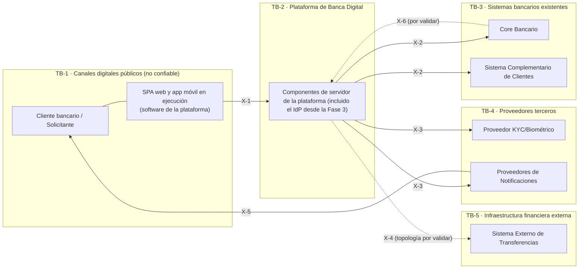

# 14 — Límites de confianza

| Campo | Valor |
|---|---|
| Fase | 2 — C4 Nivel 1: Contexto del sistema |
| Estado | Vista conceptual. **No es el diseño de seguridad de red** ni la arquitectura Zero Trust, que se definen en fases posteriores |
| Documentos relacionados | [12 — Contexto del sistema](12-contexto-del-sistema.md), [13 — Catálogo de integraciones](13-catalogo-de-integraciones.md) |

## 1. Propósito

Un **límite de confianza** (*trust boundary*) es una frontera en la que cambia el nivel de confianza sobre los datos, las identidades o el entorno de ejecución. Al cruzarla deben aplicarse controles.

### 1.1 Frontera de software vs. límite de confianza

| Concepto | Qué delimita | Ejemplo en esta plataforma |
|---|---|---|
| **Frontera de sistema de software (C4)** | Propiedad y responsabilidad sobre el software | La app móvil **pertenece** a la Plataforma de Banca Digital |
| **Límite de confianza** | Nivel de confianza del entorno y de los datos | La app móvil **se ejecuta** en un dispositivo no confiable, fuera del control de la institución |

Representar los límites de confianza dentro del diagrama C4 obligaría a partir el sistema en diseño o a dibujar zonas de red en un nivel que no las admite. Por eso se usa esta **vista conceptual separada**.

## 2. Zonas de confianza

| ID | Zona | Contenido | Nivel de confianza |
|---|---|---|---|
| TB-1 | **Canales digitales públicos** | Dispositivos del cliente, navegador, app móvil y SPA en ejecución, redes públicas | **No confiable.** El dispositivo puede estar comprometido |
| TB-2 | **Plataforma de Banca Digital** | Componentes de servidor de la plataforma | Confiable bajo el control de la institución |
| TB-3 | **Sistemas bancarios existentes** | Core Bancario, Sistema Complementario, base de datos principal | Confiable. Contiene los activos de mayor valor y debe protegerse incluso de la propia plataforma (mínimo privilegio) |
| TB-4 | **Proveedores terceros** | KYC/Biometría, Notificaciones, *(Fase 3: el IdP es interno, TB-2; ADR-0013)* | Confianza contractual y limitada |
| TB-5 | **Infraestructura financiera externa** | Sistema Externo de Transferencias e infraestructura de pagos interbancarios | Confianza regulada e interinstitucional |

## 3. Vista conceptual

> Vista conceptual. **No** es un diagrama C4 ni un diagrama de red.

## 4. Cruces de límites e implicaciones de seguridad

| Cruce | Desde → hacia | Flujos | Preocupaciones de seguridad (conceptuales) | Decisiones relacionadas |
|---|---|---|---|---|
| **X-1** | TB-1 → TB-2 | REL-01, REL-02 | Autenticación del cliente y del dispositivo. Autorización por cliente y por operación. Robo de tokens (QA4). Automatización y fraude. Validación estricta de entradas. Limitación de tasa. **Ningún control de seguridad se confía al código del cliente.** Ningún secreto de servidor en la app. Cifrado en tránsito | ADR-0002, DD-03, DD-04 |
| **X-2** | TB-2 → TB-3 | REL-03, REL-04 | Autenticación mutua entre sistemas. Mínimo privilegio por ACL y por operación. Protección del Core ante sobrecarga. No exposición del modelo interno (S6). Trazabilidad y auditoría de cada operación. Sin acceso directo a la base de datos principal (S12) | ADR-0001, ADR-0003, ADR-0009 |
| **X-3** | TB-2 → TB-4 | REL-06, REL-07 (REL-11 retirada en la Fase 3: IdP interno) | Riesgo de tercero. Minimización de datos. Datos biométricos (categoría sensible). Residencia y transferencia internacional de datos. Retención y eliminación en el proveedor. Autenticación de la plataforma ante el proveedor. Disponibilidad del proveedor | ADR-0010, DD-12, DD-14 |
| **X-4** | TB-2 → TB-5 (directa o indirecta) | REL-05 | Integridad y no repudio de las órdenes de pago. Requisitos del operador del sistema de pagos. Resultado incierto (`UNKNOWN`). Conciliación interinstitucional | ADR-0005, ADR-0006, DD-16 |
| **X-5** | TB-4 → TB-1 | REL-08, REL-09 | La entrega ocurre **fuera del control de la institución**. SMS y correo no son canales confidenciales: minimizar el contenido. Riesgo de suplantación de mensajes de la institución (*phishing*): las notificaciones no deben incluir enlaces ni solicitar datos sensibles | DD-12 |
| **X-6** | TB-3 → TB-2 | REL-13 (por validar) | Autenticidad e integridad de los avisos entrantes. Duplicados y orden. Si existe, no debe abrir un canal de entrada no autenticado hacia la plataforma | Q-04, DD-01 |

## 5. Lo que este documento no decide

- Segmentación de red, zonas desmilitarizadas, WAF y su ubicación (fase de infraestructura).
- Mecanismos concretos de autenticación entre sistemas (mTLS u otros), gestión de secretos y de claves.
- Arquitectura Zero Trust completa.
- Controles de protección de la app móvil (detección de dispositivos manipulados, protección en tiempo de ejecución).

Estos elementos se abordan en la fase de seguridad. Este documento les da el punto de partida: **qué se cruza, dónde y con qué datos**.
