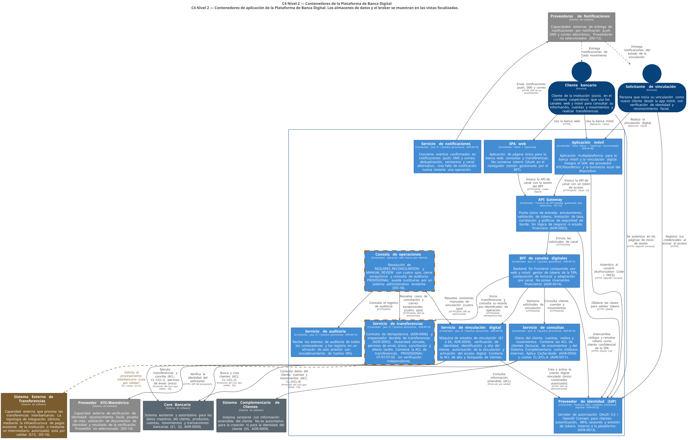
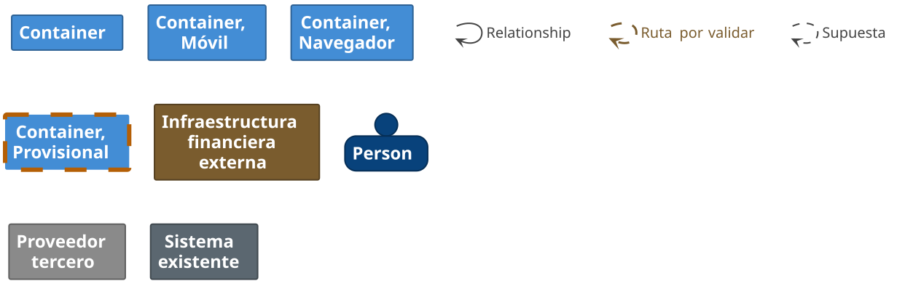

# 16 — Arquitectura de contenedores (C4 Nivel 2)

| Campo | Valor |
|---|---|
| Fase | 3 — C4 Nivel 2: Contenedores |
| Estado | **Completada; pendiente de la revisión ARG-02.** No autoriza implementación productiva |
| Fuente autoritativa | [`c4/workspace.dsl`](../c4/workspace.dsl): vista `Contenedores` y vistas focalizadas |
| Documentos relacionados | [17 — Responsabilidades](17-matriz-de-responsabilidades.md), [18 — Datos](18-propiedad-y-consistencia-de-datos.md), [19 — Comunicación](19-comunicacion-entre-contenedores.md), [20 — Descomposición](20-alternativas-de-descomposicion.md), [21 — Tecnología](21-alternativas-tecnologicas.md), [22 — Seguridad](22-seguridad-entre-contenedores.md), [23 — Riesgos y condiciones](23-riesgos-y-condiciones-fase-3.md) |

## 1. Propósito y punto de partida

Este documento describe los contenedores ejecutables de la Plataforma de Banca Digital. Conserva el contexto de la Fase 2 ([12](12-contexto-del-sistema.md)) con un único cambio: el IdP candidato externo pasa a ser un **contenedor interno** ([ADR-0013](adr/ADR-0013-frontera-del-idp.md)).

**Gobierno de esta fase.** La verificación ARG-01-R2 emitió un CONDITIONAL GO. CF-01 y CF-02 están remediados en diseño, pero **sin verificación independiente**. Por eso cada contenedor tiene un estado de diseño explícito. **El orquestador de transferencias es PROVISIONAL**: se modela, pero su protocolo de ejecución no se declara aprobado ([23](23-riesgos-y-condiciones-fase-3.md)).

| Estado de diseño | Significado |
|---|---|
| **Aprobado** | Sin condiciones abiertas (ningún contenedor está en este estado antes de ARG-02) |
| **Aprobado con condiciones** | Diseño propuesto para aprobación en ARG-02, con condiciones explícitas |
| **Provisional** | Modelado para continuar el diseño; **no aprobado** |
| **Diferido** | Decisión pospuesta con disparador |
| **Bloqueado** | No puede avanzar sin resolver una condición |

## 2. Descomposición seleccionada

Arquitectura **híbrida**: cinco servicios de dominio, un BFF compartido, un API Gateway y un IdP interno, más los almacenes y el broker ([ADR-0012](adr/ADR-0012-descomposicion-hibrida-de-contenedores.md), matriz en [20](20-alternativas-de-descomposicion.md): B = 4,15 frente a A = 3,27 y C = 3,13).

## 3. Diagramas

### 3.1 Vista principal (contenedores de aplicación)

Los almacenes de datos y el broker se omiten en la vista principal para no sobrecargarla. Aparecen en las vistas focalizadas.

### 3.2 Vistas focalizadas

| Vista | Diagrama |
|---|---|
| Consultas | [structurizr-Contenedores-Consultas.svg](../diagrams/c4/structurizr-Contenedores-Consultas.svg) |
| Vinculación digital | [structurizr-Contenedores-Vinculacion.svg](../diagrams/c4/structurizr-Contenedores-Vinculacion.svg) |
| Transferencias (provisional) | [structurizr-Contenedores-Transferencias.svg](../diagrams/c4/structurizr-Contenedores-Transferencias.svg) |
| Notificaciones y auditoría | [structurizr-Contenedores-NotificacionesAuditoria.svg](../diagrams/c4/structurizr-Contenedores-NotificacionesAuditoria.svg) |
| Integración con el Core | [structurizr-Contenedores-IntegracionCore.svg](../diagrams/c4/structurizr-Contenedores-IntegracionCore.svg) |

Convención visual: los contenedores **provisionales** llevan borde naranja discontinuo; los almacenes se dibujan como cilindros y el broker como tubería.

## 4. Inventario de contenedores

**21 contenedores**, contados directamente en `c4/workspace.dsl`. *Corrección de ARG-02:* la Fase 3 informó 16 por agrupar almacenes en una misma fila (ARG02-L01). La remediación agregó el almacén de sesiones del BFF (ADR-0019) y el diario de autorización de despacho (ADR-0021).

| # | Contenedor | Tipo | Responsabilidad principal | Tecnología (estado) | Estado de diseño |
|---|---|---|---|---|---|
| 1 | SPA web | Aplicación de navegador | Banca web; sin tokens en el navegador | React + TypeScript ([ADR-0018](adr/ADR-0018-stack-de-frontend.md)) | Aprobado con condiciones |
| 2 | Aplicación móvil | Aplicación móvil | Banca móvil y vinculación digital; SDK KYC; biometría local | React Native + TypeScript (recomendado) | Aprobado con condiciones |
| 3 | API Gateway | Borde | Enrutamiento, validación de tokens, limitación de tasa, correlación | Producto gestionado (DD-15) | Aprobado con condiciones |
| 4 | BFF de canales digitales | Aplicación (proceso sin estado) | Gestor de tokens de la SPA; composición de lecturas; adaptación por canal | Java 21 / Quarkus (provisional, [ADR-0017](adr/ADR-0017-stack-de-backend.md)) | Aprobado con condiciones |
| 5 | Almacén de sesiones del BFF | Almacén | Sesiones web y tokens cifrados ([ADR-0019](adr/ADR-0019-sesiones-del-bff.md)) | Clave-valor en memoria con alta disponibilidad (DD-15) | Aprobado con condiciones |
| 6 | Proveedor de identidad (IdP) | Aplicación | OAuth 2.0 / OIDC, MFA, sesiones, operación de vinculación acotada | Candidato Keycloak (provisional, [ADR-0013](adr/ADR-0013-frontera-del-idp.md)) | Aprobado con condiciones |
| 7 | BD del IdP | Almacén | Cuentas, credenciales, factores, sesiones (clúster aislado) | PostgreSQL ([ADR-0016](adr/ADR-0016-persistencia-y-durabilidad-del-estado.md)) | Aprobado con condiciones |
| 8 | Servicio de consultas | Aplicación | Cliente, cuentas, saldos, movimientos y contactos; ACL de lectura; Cache-Aside | Java 21 / Quarkus (provisional) | Aprobado con condiciones |
| 9 | BD de consultas | Almacén | Outbox de auditoría (una de las dos rutas, [ADR-0020](adr/ADR-0020-politica-de-auditoria-por-categoria.md)) | PostgreSQL | Aprobado con condiciones |
| 10 | Caché de consultas | Almacén derivado | Datos derivados según la matriz de cacheabilidad | Compatible con Redis (provisional, DD-07) | Aprobado con condiciones |
| 11 | Servicio de vinculación digital | Aplicación | Etapas E1 a E6; ACL de alta y búsqueda; operación de vinculación | Java 21 / Quarkus (provisional) | Aprobado con condiciones. **Ejecución y recuperación del alta en el Core: BLOQUEADAS** (ARG02-C01); **ruta `PRE_EXISTING` bloqueada en producción** (DD-21) |
| 12 | BD de vinculación | Almacén | Estado de vinculación, evidencia, outbox; PT-01 a PT-03 y PT-07 | PostgreSQL | Aprobado con condiciones |
| 13 | Servicio de transferencias | Aplicación | Idempotencia, orquestador durable, ACL de transferencias, conciliación | Java 21 / Quarkus (provisional) | **PROVISIONAL** |
| 14 | BD transaccional de transferencias | Almacén | Estado financiero de la plataforma (no un libro mayor) | PostgreSQL con PT-01 a PT-03 y PT-07 | **PROVISIONAL** |
| 15 | Diario de autorización de despacho | Almacén | Evidencia independiente de despacho; época regional ([ADR-0021](adr/ADR-0021-diario-de-autorizacion-de-despacho.md)) | Por seleccionar (DD-23) | **PROVISIONAL** |
| 16 | Broker de mensajería | Mensajería | Eventos del outbox; segunda ruta de auditoría | Gestionado (DD-15, [ADR-0015](adr/ADR-0015-mensajeria-asincrona-con-outbox.md)) | Aprobado con condiciones |
| 17 | Servicio de notificaciones | Aplicación | Notificaciones push, SMS y correo; registro de dispositivos | Java 21 / Quarkus (provisional) | Aprobado con condiciones |
| 18 | BD de notificaciones | Almacén | Deduplicación, intentos, preferencias, tokens de dispositivo | PostgreSQL | Aprobado con condiciones |
| 19 | Servicio de auditoría | Aplicación | Ingesta, deduplicación, encadenamiento por partición | Java 21 / Quarkus (provisional) | Aprobado con condiciones |
| 20 | Almacén de auditoría | Almacén | Solo anexión, cadenas por partición, archivo inmutable | PostgreSQL + almacenamiento de objetos inmutable | Aprobado con condiciones |
| 21 | Consola de operaciones | Aplicación interna | Conciliación y revisión manual, cierre excepcional, auditoría; personal autenticado con el IdP corporativo | Por definir | **PROVISIONAL** (DD-18) |

**No son contenedores:**

- el Integration Platform SDK (biblioteca, ADR-0003);
- las ACL (módulos internos);
- los roles de conciliación (procesos internos de los servicios dueños del estado).

**No se modelan dentro de la plataforma:** el Core Bancario, el Sistema Complementario y su base de datos principal (S12).

## 5. API Gateway y BFF

Ver [ADR-0014](adr/ADR-0014-api-gateway-y-bff-de-canales.md). En resumen:

- **Gateway:** enrutamiento, validación de tokens en el borde, limitación de tasa, correlación, políticas de seguridad de borde y observabilidad.
- **BFF compartido:** gestor de tokens de la SPA, composición de lecturas y adaptación por canal. **No posee invariantes financieros** y no genera ni altera claves de idempotencia.
- **Servicios de dominio:** orquestación de negocio, autorización de negocio y estado financiero.

**R1 («API Gateway que orqueste al menos 3 servicios»):** el Gateway es la puerta de entrada que expone y enruta los tres servicios exigidos. La orquestación de las llamadas externas según el tipo de transferencia vive en el servicio de transferencias, donde puede hacerse con seguridad (ADR-0002, ADR-0005).

## 6. Integración con el Core

Las ACL son **módulos internos** del servicio dueño ([ADR-0012](adr/ADR-0012-descomposicion-hibrida-de-contenedores.md)). El detalle de la comunicación (pools, concurrencia, timeouts, Circuit Breaker, presión de retorno, restricciones de reintento) y de la protección de la capacidad del Core está en [19](19-comunicacion-entre-contenedores.md).

| ACL | Servicio | Operaciones del Core | Clase de capacidad | Dueño del contrato |
|---|---|---|---|---|
| Clientes (lectura) | Consultas | Datos básicos del cliente | CL-3 | Equipo del servicio de consultas |
| Movimientos | Consultas | Cuentas, saldos, movimientos | CL-3 / CL-4 | Equipo del servicio de consultas |
| Sistema Complementario | Consultas | Datos extendidos | CL-3 (presupuesto propio del Sistema Complementario) | Equipo del servicio de consultas |
| Alta y búsqueda de clientes | Vinculación | Búsqueda por identificación, alta | CL-2 (búsqueda) / CL-1 (alta) | Equipo del servicio de vinculación |
| Transferencias | Transferencias | Ejecución, consulta de estado, reverso | CL-1 / CL-2 | Equipo del servicio de transferencias |

**No hay acceso a la base de datos principal** compartida por el Core y el Sistema Complementario (S12): ninguna decisión aprobada lo justifica.

## 7. Transferencias — diseño provisional

### 7.1 Fronteras exactas

| Frontera | Dónde vive | Qué hace | Qué no hace |
|---|---|---|---|
| **Manejo de la API** | Servicio de transferencias (capa de entrada) | Valida la clave y la huella; reserva atómicamente (IC-06, IC-07, IC-15); devuelve el identificador de operación y el estado | No invoca al Core en la solicitud del cliente; no reintenta |
| **Estado transaccional durable** | BD transaccional de transferencias | Intenciones, estado, titularidad y token, permisos de envío, evidencia huérfana, casos | No es un libro mayor; no es la fuente del saldo |
| **Ejecución financiera externa** | Rol ejecutor del servicio de transferencias + ACL de transferencias | Titularidad cercada → cupo → permiso único → envío único (ADR-0005 §4.2) | No envía sin un permiso confirmado; no reenvía |
| **Conciliación** | Rol conciliador del servicio de transferencias | Clasifica la evidencia (EV-POS, EV-REJ, EV-NOEXEC, EV-INC); consume la evidencia huérfana; escala | No cierra con EV-INC; no ejecuta un segundo reverso |
| **Intervención operativa** | Consola de operaciones (provisional) → API de operaciones del servicio | Resolución con evidencia y cuatro ojos; cierre excepcional con autoridad superior | **No crea operaciones financieras en nombre del cliente** (PT-05); no habilita automáticamente una nueva intención equivalente |

### 7.2 Garantías: qué es interno y qué es externo

| Garantía | Proveedor | Estado |
|---|---|---|
| Deduplicación por (ámbito, clave) y unicidad de equivalentes | Plataforma (almacén con unicidad) | Diseño; requiere PT-01 |
| Titularidad cercada y permiso de envío único | Plataforma (CAS en el almacén) | Diseño; requiere PT-01 a PT-03 y PT-06 |
| Que la red y los intermediarios no dupliquen | **Supuesto S19** | **No verificado** (Q-17) |
| Que el Core ejecute una sola vez cada solicitud | **Supuesto S20** | **No verificado** (Q-17) |
| Idempotencia nativa del Core | Core (G2) | **No se asume** (S3) |
| Idempotencia del procesador de pagos externo | Sistema Externo de Transferencias | **No se asume** (Q-01) |
| No ejecución de un envío tardío | Core (cierre por referencia o expiración, DD-22) | **No disponible** mientras no se valide |
| Exactamente una vez de extremo a extremo | — | **No se afirma** |

### 7.3 Por qué es PROVISIONAL

- CF-01 y CF-02 no tienen verificación independiente.
- Las condiciones PT-01 a PT-06 ([23](23-riesgos-y-condiciones-fase-3.md)) son bloqueantes antes de cualquier implementación.
- La topología interbancaria depende de Q-01.

**No se implementa la ejecución de transferencias en la Fase 3.**

## 8. Notificaciones y auditoría

| Tipo de evento | Origen | Ejemplos | Canales | Garantía |
|---|---|---|---|---|
| **Movimiento financiero confirmado** | Servicio de transferencias (outbox) | Débito confirmado, transferencia completada, reverso confirmado | Push + SMS o correo (al menos dos, R4) | Al menos una vez; deduplicación por (evento, canal); canal alternativo si el principal falla |
| **Actualización de estado pendiente** | Servicio de transferencias | En verificación, en revisión | Push (y correo si se escala) | Al menos una vez; **nunca afirma éxito ni falla** |
| **Seguridad** | IdP, vinculación | Nuevo dispositivo, activación del acceso, cambio de credenciales | Push + SMS | Al menos una vez; prioridad alta |
| **Alertas operativas** | Todos los servicios | Antigüedad en `REQUIRES_RECONCILIATION`, acumulación del outbox | Herramientas de operación (no el cliente) | Monitoreo |

- **Reintentos:** por proveedor con espera exponencial y con un plazo máximo. Si un proveedor no está disponible: canal alternativo y luego cola de mensajes fallidos con alerta.
- **Duplicados:** aceptables en el límite (entrega al menos una vez) y minimizados con deduplicación.
- **Independencia:** una falla de notificación **nunca revierte** una operación confirmada, y **una notificación no es la fuente** de la operación.
- **Evidencia:** cada intento de entrega se registra (BD de notificaciones) y genera un evento de auditoría.
- **Auditoría:** cada servicio escribe sus eventos de auditoría en su outbox **en la misma transacción** que la acción. El servicio de auditoría los consume y los anexa con encadenamiento de hashes (detalle en [18](18-propiedad-y-consistencia-de-datos.md)).

## 9. Caché y experiencia del cliente (resolución de diseño de M03)

| Regla | Detalle |
|---|---|
| Qué se cachea | Solo en el servicio de consultas y según la matriz de [06](06-estrategia-de-cache.md). El saldo disponible y los movimientos recientes son condicionales; el estado de una transferencia **nunca** se cachea |
| No autoritativo | Ningún dato en caché decide una operación ni prueba un resultado |
| Frescura y TTL | El TTL de seguridad de cada categoría se acuerda con negocio y queda registrado en la configuración, con un responsable (TTL gobernado). Toda respuesta derivada de la caché lleva la marca de tiempo de origen |
| Invalidación | Por evento (ADR-0015) tras las operaciones propias. **Carrera de Cache-Aside:** cada invalidación deja una **marca de invalidación** con instante; un llenado que comenzó antes de esa marca se descarta |
| *Read-your-writes* | Tras una operación propia, el BFF marca la sesión y el servicio de consultas **omite la caché** de saldo y movimientos de las cuentas afectadas durante `VENTANA_RYW` (por acordar) |
| Caída de la caché | Consulta directa al Core dentro de la cuota CL-3; si no hay cupo, respuesta degradada con indicador |
| Indicadores de antigüedad | La interfaz muestra «actualizado a las hh:mm» en los saldos y movimientos derivados |
| Después de una transferencia incierta | La interfaz **consulta el estado por identificador de operación** (`GET /v1/transfers/{operationId}`) al servicio de transferencias, a través del BFF. **Nunca interpreta un saldo sin cambios como prueba de que una transferencia no se ejecutó.** El BFF agrega a la lista de movimientos las operaciones en curso con su estado («en verificación»), y la operación equivalente está bloqueada (IC-15) |

**Estado de M03:** resuelto en diseño en la Fase 3; pendiente de verificación en ARG-02.

## 10. Identidad y vinculación

Ver [22](22-seguridad-entre-contenedores.md). **Punto de control único:** solo el servicio de vinculación puede crear o activar una cuenta digital en el IdP, y solo desde `LINK_AUTHORIZED`. Para un cliente `PRE_EXISTING`, `LINK_AUTHORIZED` exige la prueba de control independiente de DD-21. **La ruta queda deshabilitada (*fail-closed*) en producción** mientras DD-21 no esté implementada y probada.

## 11. Atributos de calidad por contenedor

| Contenedor | Disponibilidad | Tolerancia a fallas | Recuperación | Seguridad | Auditabilidad | Escalabilidad | Rendimiento | Mantenibilidad | Observabilidad | Costo |
|---|---|---|---|---|---|---|---|---|---|---|
| SPA / App | Depende del Gateway y del BFF | Reintento seguro con la misma clave | Estado por identificador de operación | Sin tokens en el navegador; almacenamiento seguro en el móvil | Acciones auditadas en el backend | Distribución estática y tiendas | Caché del cliente | Código TypeScript compartido | Telemetría del cliente sin datos personales | Bajo |
| API Gateway | **Crítica** (punto de entrada) | Redundancia multizona | Sin estado | Validación de tokens, WAF, limitación de tasa | Registros de acceso | Horizontal | Baja latencia | Configuración como código | Correlación de solicitudes | Medio |
| BFF | Alta | Proceso sin estado; sesión en un almacén externo (ADR-0019) | Volver a iniciar sesión si se pierde el almacén | Gestor de tokens; sin invariantes | Correlación | Horizontal | Composición | Rutas por canal | Trazas | Medio |
| IdP | **Crítica** | Multizona; BD replicada | Respaldo y restauración | Credenciales, MFA, sesiones | Eventos de seguridad | Horizontal | — | Producto | Eventos | Medio |
| Consultas | Alta | Degradación con caché y Circuit Breaker | Sin estado crítico | Autorización por propiedad de cuenta | Consultas auditadas | Horizontal (CL-3 por réplica) | Caché | ACL con pruebas de contrato | Métricas por clase | Medio |
| Vinculación | Alta | Estados durables; proveedor no disponible ≠ rechazo | Recuperación de los estados en curso | Datos biométricos; punto de control del acceso | Cada etapa auditada | Moderada | — | Máquina de estados | Antigüedad por estado | Medio |
| Transferencias | Alta, **subordinada a la integridad** | Falla segura; `UNKNOWN`; sin reenvíos | **PT-01 a PT-03**; cuarentena | Autorización por operación; QA4 | Cada transición auditada | Limitada por CL-1 | — | Alta complejidad (RR-08) | Antigüedad por estado; permisos | Medio |
| Notificaciones | Media (no bloquea la operación) | Canal alternativo; mensajes fallidos | Reprocesamiento desde el broker | Contenido minimizado | Intentos registrados | Horizontal | Asíncrona | — | Tasa de entrega | Bajo-medio |
| Auditoría | Alta para la ingesta (sin pérdida) | El outbox de origen protege ante caídas | Archivo inmutable | Acceso restringido; solo anexión | **Es la evidencia** | Horizontal | Asíncrona | — | Retraso de ingesta | Medio |
| Consola (provisional) | Media | — | — | Cuatro ojos; acceso privilegiado | Toda acción auditada | Baja | — | — | — | Bajo |

Las cifras de disponibilidad, RTO y RPO **no se fijan aquí**. Los objetivos candidatos están en ARG-01 §12.5 y siguen pendientes de confirmación institucional. La única excepción no negociable es el **RPO 0 de las escrituras confirmadas** del almacén transaccional (PT-01) y la **confirmación por quórum** del diario de autorización de despacho (PT-07, ADR-0021).
